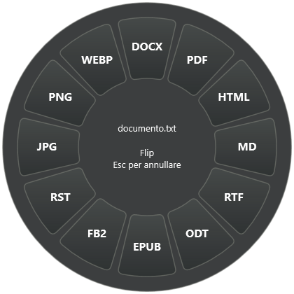

# FLIP v0.6.0 — AURA Edition


Converti qualsiasi file direttamente da Esplora File o dal Desktop: trascina uno o più file, premi **Freccia Giù** (o il tasto personalizzato) e rilascia su uno spicchio della ruota. FLIP elabora tutto **100% in locale** e salva la copia convertita accanto al file originale senza mai sovrascrivere gli originali.



[Demo (MP4)](docs/assets/flip-demo.mp4) · [Note di Rilascio v0.6.0](https://github.com/thetinyfoundry/FLIP/releases/tag/v0.6.0) · [Changelog](CHANGELOG.md) · [Guida Windows](docs/WINDOWS-INSTALL.md) · [Architecture](ARCHITECTURE.md)

---

## Installazione in 1 Clic

Requisito di sistema: **Windows 10 / 11 (x64)** con [.NET 10 Windows Desktop Runtime x64](https://dotnet.microsoft.com/download/dotnet/10.0).

### Metodo Rapido (Archivio Release `.zip`)
1. Scarica ed estrai l'intero archivio `Flip-0.6.0-win-x64.zip` dalle [GitHub Releases](https://github.com/thetinyfoundry/FLIP/releases).
2. Fai **doppio clic su `Installa-FLIP.cmd`**.
   - Verifica automaticamente tutti gli hash `SHA256SUMS.txt` prima della copia.
   - Installa FLIP in `%LOCALAPPDATA%\Programs\Flip`, crea i collegamenti su Desktop e Menu Start e avvia subito il **Tutorial Guidato Interattivo** in 4 passaggi.
3. Per disinstallare in qualsiasi momento, fai doppio clic su **`Disinstalla-FLIP.cmd`**.

### Metodo PowerShell da Sorgente o Pacchetto Estratto
```powershell
powershell -NoProfile -ExecutionPolicy Bypass -File .\scripts\Install.ps1
```
Usa `-NoShortcuts`, `-NoStartup` o `-NoLaunch` se desideri escludere collegamenti, avvio automatico o avvio immediato.

---

## Cosa rende unico FLIP v0.6.0 ("AURA Edition")

- **Ruota Radiale Multi-Monitor con Flip Verticale 3D & Aura Luminosa (`Wheel` & `ScreenEdgeAuraWindow`)**:
  - Sotto-anelli concentrici (`Sub-Rings`) per gestire oltre 298 estensioni su 18 categorie senza affollamento e senza sbalzi grafici.
  - **Ribaltamento 180° (`Tab` / Rotellina)** tra **Fronte (Formati)** e **Retro (Strumenti Rapidi Creator)**: *Turntable 360° 3D GIF*, *Palette #HEX*, *Onda Sonora trasparente*, *Crop 9:16 Social Blur*, *Privacy EXIF/Metadata*, *Merge PDF*, *Remove BG*, *OCR*, *Rotazione*, *Target MB*, *Pack ZIP* (+ combinabile `+ ARCHIVIO .ZIP` con `Z`).
  - **Traccia dell'Ultima Scelta (`#FFB547`)**: ricorda in RAM l'ultimo formato convertito con successo per estensione e evidenzia con un arco ambra lo spicchio corrispondente (anche dentro `+ EXTRA`) senza alterare l'ordine naturale degli spicchi.
  - **Aura luminosa ai bordi del monitor** compatibile con più schermi, tavolette grafiche a DPI misti e posizionamento fisico forzato al cursore.
- **QuickLook Istantaneo (`Spazio` durante il drag — `FlipPreviewWindow`)**:
  - **Viewport 3D interattivo (`.obj`, `.fbx` binari & ASCII, `.stl`, `.ply`, `.glb`, `.gltf`, `.3mf`, `.dae`)** + vista **Blueprint a 4 Viste** (`Tab`) + **Segnalibro Inquadratura `(A)`** (`📌 Memorizza Vista (A)` / `↺ Richiama Vista (A)` con salvataggio di orientamento, pan, zoom e auto-giro).
  - **Palette #HEX & Provino Tipografico `"Aa"`**: estrae i 6 colori dominanti e consente di provare qualsiasi coppia *Testo / Sfondo* con calcolo reale del contrasto WCAG (`⇄ Scambia` + copia `#TESTO / #SFONDO`).
  - **Audio, Testo & Codici**: anteprima e salvataggio su disco solo premendo `Ctrl+S` (nessun file temporaneo nella cartella dell'utente).
- **Conversione Nativa PDF/A-2b (ISO 19005-2 PA/Legale)**:
  - Genera PDF/A conformi (`%PDF-1.7`, metadati XMP `pdfaid:part=2` / `conformance=B`, `OutputIntents` `sRGB IEC61966-2.1` + profilo ICC) direttamente da PDF (`_pdfa.pdf`), immagini e documenti di testo tramite `PdfEngine`.
- **Trascrizione Audio/Video Offline con Whisper AI (`LocalAiEngine` & `WhisperLocator`)**:
  - Pipeline locale *Audio/Video → WAV 16 kHz mono → TXT / SRT* puliti, rilevamento intelligente *Zero-Duplicati* sul PC con esclusione automatica di ambienti Python parziali (`python_embeded`/`venv`/`conda`).
- **Recupero del Batch Misto (Ruota & Hub)**:
  - Trascinando file eterogenei (es. `8 PNG, 2 WAV, 1 PDF`), FLIP mostra pillole cliccabili/selezionabili per ogni gruppo omogeneo invece di bloccarsi su *"Nessun formato comune"*.
- **Modalità Accessibilità Tobii / Senza Mani (`GazeOrbWindow` & `GazeDwell`)**:
  - Bollino `[ F ]` discreto ancorato al bordo destro (`Opacity = 0.35`, risveglio a `1.0` entro `90px`, trascinabile verticalmente) + selezione a sosta dello sguardo (Dwell `600–2500ms`) su Ruota e QuickLook senza usare mouse o tastiera.
- **Settings Hub Unificato a 6 Sezioni (`SettingsHubWindow`) & Installer 1-Click Motori**:
  - Sezioni scure borderless: `1. Ruota & Spicchi`, `2. Attivazione & Input`, `3. Destinazione File`, `4. Motori & GPU` (verifica live su disco + installer 1-Click per `whisper`, `pandoc`, `ffmpeg`, `tesseract`, `calibre`, `libreoffice`), `5. Cartelle Automatiche`, `6. Cronologia & Preset` (con `StripMetadata`).

---

## Formati e Motori Supportati

| Categoria | Sorgenti Principali | Destinazioni Principali | Motore |
| --- | --- | --- | --- |
| **Immagini** | PNG, JPG/JPEG, WebP, BMP, TIFF, GIF, ICO | PNG, JPG, WebP, PDF, PDF/A, BMP, TIFF, GIF, ICO | Built-in (`ImageEngine`) |
| **PDF & Archivio PA** | PDF | PDF/A-2b (`_pdfa.pdf`), PNG, JPG, WebP, TXT, DOCX/ODT/MD | Built-in (`PdfEngine`) / Pandoc |
| **Documenti & Office** | TXT, MD, HTML, DOCX, ODT, RTF, EPUB | DOCX, ODT, RTF, PDF, PDF/A, HTML, MD, TXT, EPUB | Built-in (`OfficeOpenXmlEngine`) / Pandoc / LibreOffice |
| **Dati Strutturati** | JSON, JSONL, YAML, TOML, XML, CSV, TSV, INI | JSON, JSONL, YAML, TOML, XML, CSV, TSV, INI, HTML, MD, XLSX | Built-in (`DataSerializationEngine`) |
| **3D, CAD & Geo** | OBJ, STL, PLY, FBX, GLB, GLTF, 3MF, DAE, SVG, DXF, GPX, KML, GeoJSON | Tutte le mesh 3D inter-formato + Blueprint PNG/PDF + Turntable GIF + SVG/DXF/Geo | Built-in (`Mesh3DVectorGeoEngine`) |
| **Archivi** | ZIP, TAR, GZ, TGZ, CBZ, EPUB, 7Z, RAR | ZIP, TAR, GZ, TGZ, CBZ, 7Z | Built-in (`ArchiveEngine`, Zip-Slip safe) |
| **Audio & Video + AI** | WAV, MP3, FLAC, OGG, M4A, AAC, OPUS, MP4, MKV, WebM, AVI, MOV | Audio, Video, GIF/WebP, **TXT / SRT** (trascrizione offline) | FFmpeg / Media Foundation / Whisper AI |

---

## Architettura del Repository

```text
src/Flip/
├── Core/                  # Catalogo FormatRegistry (298+ est.), FlipSettings, SettingsStore atomico, OutputPathAllocator (lease)
├── Routing/               # RoutePlanner BFS multi-hop (isolamento dominio), IConversionEngine, IQuickTool
├── Engines/               # Image, Pdf (PDF/A-2b), OfficeOpenXml, DataSerialization, Archive, Mesh3DVectorGeo, ExternalCli + QuickTools
├── SettingsHub/           # SettingsHubWindow a 6 sezioni dark-theme, WheelStudio, Output, Motori 1-Click, Watch Folders, Preset
├── Wheel.cs / Layout      # Ruota radiale, Sub-Rings, multi-monitor DPI, traccia ultima scelta, batch misto, Flip 3D
├── FlipPreviewWindow.cs   # FLIP QuickLook universale: Viewport 3D + Vista (A), Blueprint, Palette + Provino Aa, Testo/Audio
├── FirstRunWelcomeWindow.cs # Tutorial guidato interattivo a 4 schede con mini-ruota e coach-marks
├── GazeOrbWindow.cs       # Accessibilità Tobii Senza Mani (Auto-Dock + Dwell-to-Select)
├── ScreenEdgeAuraWindow.cs# Aura arancione ai bordi del monitor con follow multi-monitor
├── BrowserDropService.cs  # Intercettazione drag immagini/URL/Data-URI dal browser
├── ClipboardFlipService.cs# Conversione rapida dagli Appunti (Ctrl+Shift+F)
└── WatchFolderService.cs  # Monitoraggio cartelle automatico anti-loop
scripts/
├── Build.ps1              # Compilazione e publish win-x64
├── Package.ps1            # Creazione pacchetto ZIP release, pulizia PDB/log, audit privacy su Flip.dll e SHA256SUMS.txt
├── Install.ps1            # Installer per utente con verifica SHA256SUMS.txt, runtime check e avvio immediato
├── Installa-FLIP.cmd      # Launcher 1-clic per utenti Windows (ExecutionPolicy Bypass)
└── Disinstalla-FLIP.cmd   # Disinstallazione pulita di app, startup e collegamenti
```

---

## Compilazione e Verifica da Sorgente

Richiede [.NET 10 SDK (win-x64)](https://dotnet.microsoft.com/download/dotnet/10.0).

```powershell
# 1. Build Release (0 errori, 0 avvisi richiesti)
dotnet build src/Flip/Flip.csproj -c Release

# 2. Suite Automatica Input, UI, Routing & Scenari
dotnet run --project src/Flip/Flip.csproj -c Release --no-build -- --test-input

# 3. Suite Automatica Conversioni End-to-End
dotnet run --project src/Flip/Flip.csproj -c Release --no-build -- --test-conversions

# 4. Creazione Pacchetto Release ZIP + SHA256SUMS.txt
powershell -NoProfile -ExecutionPolicy Bypass -File .\scripts\Package.ps1
```

---

## Privacy & Sicurezza

- **100% Locale**: nessun dato o file viene inviato a server esterni o servizi cloud. Le conversioni avvengono in directory temporanee isolate (`%TEMP%\FLIP\Jobs\<guid>`) con commit atomico tramite lease `IDisposable` e salvataggio predefinito accanto al file originale.
- **Sicurezza I/O & 3D**: protezione Zip-Slip negli archivi, isolamento profili LibreOffice headless, blocco path traversal / URI esterni / symlink / overflow buffer sui file `.gltf`, verifica hash SHA-256 sugli installer dei motori e nei pacchetti di release.
- **Log & Export Puliti**: diagnostica locale disabilitata in produzione (`Evidence.Enabled == false` salvo flag diagnostici) con redazione di `%USERPROFILE%`, `data:` URI ed URL; esportazioni impostazioni prive di cronologia e percorsi personali.

---

## Licenza

A partire dalla **v0.6.0**, il codice originale e le risorse di FLIP sono distribuiti sotto licenza **[GNU GPLv3](LICENSE)** (`GPL-3.0-only`). Copyright © 2026 The Tiny Foundry / Raffaele Acanfora.

I componenti di terze parti mantengono le rispettive licenze riportate nelle [note sulle dipendenze](THIRD_PARTY_NOTICES.md).

[Contributing](CONTRIBUTING.md) · [Changelog](CHANGELOG.md) · [Architecture](ARCHITECTURE.md) · [Release Notes v0.6.0](https://github.com/thetinyfoundry/FLIP/releases/tag/v0.6.0)
